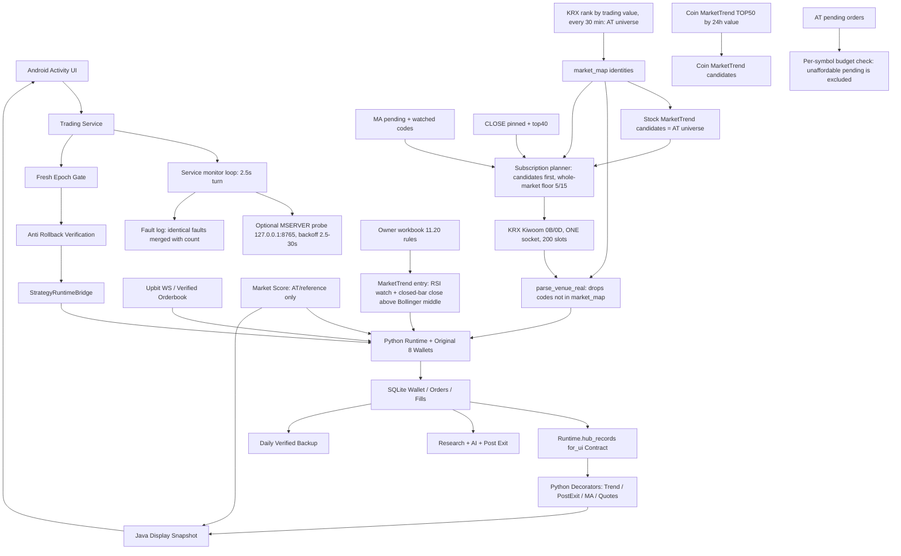

# ARTITRADE — Functional dependency management

**Single source of truth for maintained critical flows:** [dependency_graph.json](dependency_graph.json). **Version/error status:** [version_issues.json](version_issues.json) and the repository [GitHub Issues](https://github.com/OHM1121/RESALE_ALPHA/issues?q=is%3Aissue+ARTITRADE).

## Main interdependencies (updated for 0.0.20)

## Critical contracts
- **APP_START:** FreshEpochGate → LedgerAntiRollback → Java StrategyRuntimeBridge → Python engine; failed startup may show an Activity but is not running trading.
- **STOCK_FEED:** single Kiwoom WS, official KRX 0B/0D freshness, original AT/MA/GMO/CLOSE/Trend wallets. Rest history is not an executable book. Stock MA preclose has a bounded latest-per-symbol queue.
- **COIN_FEED:** authenticated Upbit ticker/depth, same-market MA/Reference/Trend separate wallets; missing high/low source metadata must not abort other book decisions.
- **HUB_UI:** source SQLite ledger → `android_runtime_v078._hub_records_v078(for_ui)` → Trend → PostExit → PolicyChronology → MA V061 → MA V062 → Stock Quote wrapper → Java bridge → Activity. **Every decorator must retain and forward `for_ui`.** Missing one keyword broke 0.0.5 UI.
- **GMO_EMPTY:** verified zero balances/positions are a healthy fresh epoch, not corruption. Unavailable and actual failures have separate states.
- **BACKUP:** KST +09:00, source SQLite WAL snapshot, independent anti-rollback witness; backup is not a UI export.
- **MKT_TREND_5M:** retired for stock/coin new entry and research. This does **not** retire reference/MA 5m or erase old holdings' exit paths.

## Full-source graph scan
`tools/artitrade/build_source_graph.py` reads (without executing) **all current Python overlays, all 22-archive original EXE strategy Python files, all Java classes and dependency references**, emits `artitrade_source_graph.json`, and labels inferred/dynamic edges as not statically verifiable. The workflow `artitrade-dependency-governance.yml` regenerates and uploads a complete per-commit artifact. If a function is registered dynamically (monkeypatch/callback/serialized event), add it to the critical [dependency_graph.json](dependency_graph.json) manually.

Static references are not equivalent to a validated real broker execution flow. Every missing, unknown or dormant dependency must be disclosed as such, not silently claimed to be inspected.

## Position identity + one-cycle cleanup (0.0.15)
- **POSITION_UID_V015**: original 8 wallet positions/BUY/SELL receipts →
  private epoch-scoped UID sidecar → read-only hub/UI history; no strategy,
  quote, broker or original SQLite wallet writes. Historical closed rows are
  indexed from native source DB, not inferred from symbol+time alone.
- **CFG_SINGLE_PAPER_CLEANUP_V015**: after original old-policy migration and
  before native runtime startup, qualify exactly one historically reported
  coin MA 5m KRW-CFG PAPER position, backup native SQLite, reverse original
  cash/P&L, delete only that position's linked receipts, rebase independent
  witness. Zero or multiple matches are SKIPPED; never bulk ticker deletion.
- Both features require original native regression and Java CI; a GitHub CI
  pass does not prove phone-side migration ran or that any live fill exists.

## 0.0.16 verified preflight visibility and Trend original value provenance
- **PRELOAD_VERIFIED_V016**: original service startup + shared, existing
  Kiwoom/Upbit WS → native preload_gate + KRX 0B/0D / Upbit ticker/book
  + verified completed candle/RSI history → read-only 0.0.16 audit and
  work-item counts → Android status/%/ETA. No new socket/order. 40s UI
  escape leaves original background repair active and never declares ready.
- **TREND_COST_PROVENANCE_V016**: original MT54 position.entry/entry_fee/mark,
  exact native execution.position_id and SELL net_pnl → read-only snapshot
  joined buy unit price/source cost/realized_pct, per-frame PnL → original
  UID display enrichment and Java holdings/execution view. Saved stock mark
  is labelled LAST SAVED NOT LIVE and never controls native SELL orders.
  Original SQLite positions, funds, quantities and policy remain unchanged.

## 0.0.17 native KRX PENDING retry and stock-symbol loading count (Issue #104)
- `STOCK_PENDING_NATIVE_RETRY_V017`: original Kiwoom ONE client →
  verified native `d_multiframe_recovery_fix14.recover_frame` →
  source `v19_higher_frame_audit14` per original pending ID →
  original PAPER D19 BUY and NEW LEGACY signed score/orderbook gate.
  The 0.0.15 phone export showed original PENDING 181 and original
  `LIVE_PARENT_GAP` blocked audits 204. 0.0.16 original retry worker
  dropped DNS exceptions, could lose work before its own 55s throttle,
  and starved retries behind the nonempty scan queue. Fix adds bounded
  retries, pending-priority and preserves actual already VERIFIED
  per-position audits against a delayed global checkpoint; a
  `VERIFIED_RESTORED` frame response with blocked pending audits still
  retries. No original wallet, trade or quote policy changes; never
  turn REST history into a buy or create a synthetic fill.
- `PRELOAD_STOCK_SYMBOLS_V017`: original selected KRX universe `N`
  (459 only when native universe really has 459) →
  one-time native `VERIFIED_RESTORED` historical response per unique code →
  monotonic `loaded/N` Android progress. Variable network audit
  checklists are separate from displayed stock-symbol %; stable count
  persists through Activity recreation. Stock-loaded 100% is NOT a
  working same-venue 0B/0D quote, an eligible market-score BUY, nor
  authenticated broker fill. The pre-existing 40-second bounded UI
  escape may show incomplete background work without falsely saying 100%.
- Regressions: `test_v017_native_pending_retry.py`,
  `test_v017_stock_preload_progress.py`,
  `test_v013_stock_at_pending_to_native_buy.py`, original eight
  wallet PAPER suites and Java compile. CI and original keystore sign
  validation do not prove DEVICE_VERIFIED real buy/market session.

## 0.0.18 NEW LEGACY(11.18) rev1 red-text F6/F7 + critical coin MA POD held exit (#107)
- `NL1118_REV1_VERIFIED_LOW_STOP_V018`: the original **MA upward
  transition signal candle** and original **MarketTrend falling-entry
  signal candle** must be read from the same authentic native officially
  completed KRX or Upbit bars; its LOW is immutable reference. During
  TP1 pending, the signal bar or a later actually completed bar must
  evidence a touch of this LOW, and an officially CLOSED bar must CLOSE
  strictly below the original reference LOW. Only then may the original
  wallet attempt a FULL SELL using current authentic same-venue BID and
  nonzero capacity. Previous MA/Trend `seen_above_entry && bid <= entry`
  no longer authorizes full SELL. The reference-bar strategy remains
  unchanged. NO retroactive sell, candle-HIGH fill or source invention.
- `MA_COIN_HELD_EXIT_PRIORITY_V018`: existing coin MA open holdings
  are examined ahead of regular candidate exploration by a bounded
  independent `~0.12s` best-effort **book freshness observer**.
  It sees only new genuine Upbit WS orderbook BID, timestamp and
  executable depth from the original UpbitPaperRunner single WS,
  passing the intact native v067 policy, SQLite ledger, broker guard,
  dedupe and native execution receipt. There is **no second websocket,
  no standalone broker sell order and NO guarantee of 120ms SELL**:
  slow database/transport and missing BID are still blocking facts.
  A 1m candle HIGH=595 or original ASK=595 cannot fill TP1=594.66
  when original verified BID maxes at 593; the existing
  `nl1118_resting_sells` are PAPER plans, not submitted orders.
- Source scope includes `ma_v067_policy.py`,
  `new_legacy_1118_policy.py`,
  `new_legacy_rev1_low_close.py`,
  `ma_v067_coin_runtime.py`, `ma_v067_stock_runtime.py`,
  `market_trend_1118_runtime.py`,
  `ma_fast_held_exit_v018.py`, and existing runner integration.
  Regression includes original eight wallets, original reference F5,
  old CFG price/path sidecar, TP1/TP2 receipt and no-false-fill.
  DEVICE_VERIFIED requires actual phone and current orderbook evidence.

## 0.0.20 — how the changed parts connect (issues #111, #112, #113, #114, #115, #116)
Delivered as APK `0.0.20` (versionCode 142), based on the released 0.0.18.
Status: `SOURCE_FIXED`; CI result and device result are recorded in
`version_issues.json` (`candidate_020`). Nothing here is `DEVICE_VERIFIED`.

### Live stock quotes: who gets a price (#116, #117)
1. **Symbol map** (`LivePaperRunner.market_map` / `krx_market_map`): the stocks the
   feed is allowed to process = the **AT universe** (top-N per market by trading
   value, ETF/ETN excluded, plus pinned holdings), rebuilt every 30 min.
   `parse_venue_real` drops any 0B print whose code is not in it.
2. **Stock MarketTrend candidates = the AT universe** (owner decision, #117).
   `stock_trend_universe_v020` replaces the stock branch of
   `market_trend_runtime_v043._refresh_rank` (no separate Kiwoom ranking request,
   no mismatch with the map). The trading-value TOP50 list remains **coin only**.
   Identity only; no price, order or fill is created there.
3. **Subscription planner** (`stock_priority_runtime_v093.allocate_priority`):
   one Kiwoom socket, at most 200 live slots shared by AT (whole market),
   CLOSE, MA, MarketTrend and GMO with weights 5:4:3:2:1. Order of claims is
   *candidate lists first, whole-market list last*; the whole-market list keeps a
   floor of 5/15 of the free slots and takes the remainder. Held/pending symbols
   stay protected and first. Because stock Trend candidates are the whole
   universe, the Trend band carries only held symbols. Before 0.0.20 the
   whole-market list claimed everything first, so the CLOSE/MA/Trend/GMO lists
   became empty and their candidates were live only ~42% of the time (#116).
4. Who consumes the prices: MarketTrend (`observe_stock_tick`, fresh-quote gate 3 s),
   MA (`ma.watched_codes()` / pending), CLOSE (raw shared messages via
   `at_close_bridge`), AT/GMO (`_new_tick` chain). Market score gates **only**
   AT/reference buys.

### Unaffordable AT pending orders (#115, #117)
`D19PaperEngine._enqueue_signals` creates `v19_orders` (PENDING) →
`stock_limit_exclusion_v020.sweep` (same transaction) compares the one-share cost
(limit + buy fee) with `symbol_limit_won(tf)` (= timeframe seed / max positions,
set by `android_operation_bridge._apply_at`) → too expensive: order status
`EXCLUDED_ABOVE_SYMBOL_LIMIT`, signal `REJECTED`, audit event
`PENDING_EXCLUDED_ABOVE_SYMBOL_LIMIT`. Such orders leave the "buy pending" list and
the 0.0.17 history-repair priority set. Nothing else is touched.

### MarketTrend entry rule (workbook sheet 11.20, issue #114)
`RSI20 <= 30` starts a 24 h watch (unchanged) → Bollinger(20,1.5) MIDDLE slope
strictly inside (-15, +20) degrees **and** a COMPLETED bar that ended after the
watch began closes strictly above its MIDDLE (`new_legacy_1118_policy.closed_bar_entry_condition`)
→ fresh verified quote/book + fees + slot + wallet (`TrendWalletV054.buy`). The
11.19 trigger (a live price reaching the MIDDLE) is retired. `entry_signal_policy`
keeps its value because `legacy_purge_v012` protects NEW LEGACY positions by it;
the rule is stored as `entry_rule=NL1120_BAR_CLOSE_ABOVE_BOLL_MID`.

### Service monitor loop (#111)
`UnifiedTradingService.monitorLoop` (every 2.5 s) → one synchronized Python
`snapshot()` per turn (its result is reused by the end-of-turn disarm) → snapshot
preferences (the UI rejects a snapshot older than 8.5-10 s) → foreground
notification only when its text changes. The optional MSERVER probe uses
`ProbeBackoff` (2.5 s while healthy, 2.5→30 s while failing) and stays
fail-closed (both lease epochs 0). Faults go to `RuntimeCrashStore` through
`FaultLogPolicy`: identical (stage, type, message) faults become one row with a
count, so a repeating benign fault cannot push other diagnostics out of the
30-row buffer.

### Packaging (#112)
The signed user APK is built from the `debug` build type with the original
signer. It is **not debuggable** unless built with `ARTITRADE_DEBUGGABLE=1` or the
emulator smoke environment. Version identifiers are numeric only
(`USER_STANDING_RULES.md` R1).

### Diagnostics (#113, #115)
`tools/artitrade/at_pending_stall_audit.py` reads an exported stock AT SQLite
read-only and prints aggregate counts only (blocked audits, touched-but-not-bought
reasons, pending orders priced above the per-symbol budget). It touches no
runtime path.

