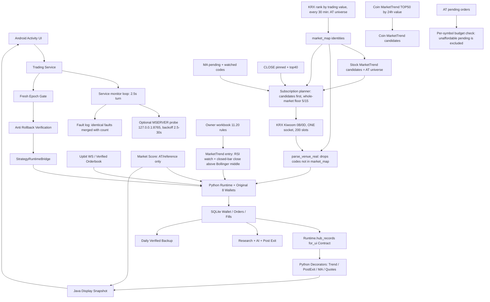

# ARTITRADE — Functional dependency management

**Single source of truth for maintained critical flows:** [dependency_graph.json](dependency_graph.json). **Version/error status:** [version_issues.json](version_issues.json) and the repository [GitHub Issues](https://github.com/OHM1121/RESALE_ALPHA/issues?q=is%3Aissue+ARTITRADE).

## Main interdependencies (updated for 0.0.20)

## Critical contracts
- **APP_START:** FreshEpochGate → LedgerAntiRollback → Java StrategyRuntimeBridge → Python engine; failed startup may show an Activity but is not running trading.
- **STOCK_FEED:** single Kiwoom WS, official KRX 0B/0D freshness, original AT/MA/GMO/CLOSE/Trend wallets. Rest history is not an executable book. Stock MA preclose has a bounded latest-per-symbol queue.
- **COIN_FEED:** authenticated Upbit ticker/depth, same-market MA/Reference/Trend separate wallets; missing high/low source metadata must not abort other book decisions.
- **HUB_UI:** source SQLite ledger → `android_runtime_v078._hub_records_v078(for_ui)` → Trend → PostExit → PolicyChronology → MA V061 → MA V062 → Stock Quote wrapper → Java bridge → Activity. **Every decorator must retain and forward `for_ui`.** Missing one keyword broke 0.0.5 UI.
- **GMO_EMPTY:** verified zero balances/positions are a healthy fresh epoch, not corruption. Unavailable and actual failures have separate states.
- **BACKUP:** KST +09:00, source SQLite WAL snapshot, independent anti-rollback witness; backup is not a UI export.
- **MKT_TREND_5M:** retired for stock/coin new entry and research. This does **not** retire reference/MA 5m or erase old holdings' exit paths.

## Full-source graph scan
`tools/artitrade/build_source_graph.py` reads (without executing) **all current Python overlays, all 22-archive original EXE strategy Python files, all Java classes and dependency references**, emits `artitrade_source_graph.json`, and labels inferred/dynamic edges as not statically verifiable. The workflow `artitrade-dependency-governance.yml` regenerates and uploads a complete per-commit artifact. If a function is registered dynamically (monkeypatch/callback/serialized event), add it to the critical [dependency_graph.json](dependency_graph.json) manually.

Static references are not equivalent to a validated real broker execution flow. Every missing, unknown or dormant dependency must be disclosed as such, not silently claimed to be inspected.

## Position identity + one-cycle cleanup (0.0.15)
- **POSITION_UID_V015**: original 8 wallet positions/BUY/SELL receipts →
  private epoch-scoped UID sidecar → read-only hub/UI history; no strategy,
  quote, broker or original SQLite wallet writes. Historical closed rows are
  indexed from native source DB, not inferred from symbol+time alone.
- **CFG_SINGLE_PAPER_CLEANUP_V015**: after original old-policy migration and
  before native runtime startup, qualify exactly one historically reported
  coin MA 5m KRW-CFG PAPER position, backup native SQLite, reverse original
  cash/P&L, delete only that position's linked receipts, rebase independent
  witness. Zero or multiple matches are SKIPPED; never bulk ticker deletion.
- Both features require original native regression and Java CI; a GitHub CI
  pass does not prove phone-side migration ran or that any live fill exists.

## 0.0.16 verified preflight visibility and Trend original value provenance
- **PRELOAD_VERIFIED_V016**: original service startup + shared, existing
  Kiwoom/Upbit WS → native preload_gate + KRX 0B/0D / Upbit ticker/book
  + verified completed candle/RSI history → read-only 0.0.16 audit and
  work-item counts → Android status/%/ETA. No new socket/order. 40s UI
  escape leaves original background repair active and never declares ready.
- **TREND_COST_PROVENANCE_V016**: original MT54 position.entry/entry_fee/mark,
  exact native execution.position_id and SELL net_pnl → read-only snapshot
  joined buy unit price/source cost/realized_pct, per-frame PnL → original
  UID display enrichment and Java holdings/execution view. Saved stock mark
  is labelled LAST SAVED NOT LIVE and never controls native SELL orders.
  Original SQLite positions, funds, quantities and policy remain unchanged.

## 0.0.17 native KRX PENDING retry and stock-symbol loading count (Issue #104)
- `STOCK_PENDING_NATIVE_RETRY_V017`: original Kiwoom ONE client →
  verified native `d_multiframe_recovery_fix14.recover_frame` →
  source `v19_higher_frame_audit14` per original pending ID →
  original PAPER D19 BUY and NEW LEGACY signed score/orderbook gate.
  The 0.0.15 phone export showed original PENDING 181 and original
  `LIVE_PARENT_GAP` blocked audits 204. 0.0.16 original retry worker
  dropped DNS exceptions, could lose work before its own 55s throttle,
  and starved retries behind the nonempty scan queue. Fix adds bounded
  retries, pending-priority and preserves actual already VERIFIED
  per-position audits against a delayed global checkpoint; a
  `VERIFIED_RESTORED` frame response with blocked pending audits still
  retries. No original wallet, trade or quote policy changes; never
  turn REST history into a buy or create a synthetic fill.
- `PRELOAD_STOCK_SYMBOLS_V017`: original selected KRX universe `N`
  (459 only when native universe really has 459) →
  one-time native `VERIFIED_RESTORED` historical response per unique code →
  monotonic `loaded/N` Android progress. Variable network audit
  checklists are separate from displayed stock-symbol %; stable count
  persists through Activity recreation. Stock-loaded 100% is NOT a
  working same-venue 0B/0D quote, an eligible market-score BUY, nor
  authenticated broker fill. The pre-existing 40-second bounded UI
  escape may show incomplete background work without falsely saying 100%.
- Regressions: `test_v017_native_pending_retry.py`,
  `test_v017_stock_preload_progress.py`,
  `test_v013_stock_at_pending_to_native_buy.py`, original eight
  wallet PAPER suites and Java compile. CI and original keystore sign
  validation do not prove DEVICE_VERIFIED real buy/market session.

## 0.0.18 NEW LEGACY(11.18) rev1 red-text F6/F7 + critical coin MA POD held exit (#107)
- `NL1118_REV1_VERIFIED_LOW_STOP_V018`: the original **MA upward
  transition signal candle** and original **MarketTrend falling-entry
  signal candle** must be read from the same authentic native officially
  completed KRX or Upbit bars; its LOW is immutable reference. During
  TP1 pending, the signal bar or a later actually completed bar must
  evidence a touch of this LOW, and an officially CLOSED bar must CLOSE
  strictly below the original reference LOW. Only then may the original
  wallet attempt a FULL SELL using current authentic same-venue BID and
  nonzero capacity. Previous MA/Trend `seen_above_entry && bid <= entry`
  no longer authorizes full SELL. The reference-bar strategy remains
  unchanged. NO retroactive sell, candle-HIGH fill or source invention.
- `MA_COIN_HELD_EXIT_PRIORITY_V018`: existing coin MA open holdings
  are examined ahead of regular candidate exploration by a bounded
  independent `~0.12s` best-effort **book freshness observer**.
  It sees only new genuine Upbit WS orderbook BID, timestamp and
  executable depth from the original UpbitPaperRunner single WS,
  passing the intact native v067 policy, SQLite ledger, broker guard,
  dedupe and native execution receipt. There is **no second websocket,
  no standalone broker sell order and NO guarantee of 120ms SELL**:
  slow database/transport and missing BID are still blocking facts.
  A 1m candle HIGH=595 or original ASK=595 cannot fill TP1=594.66
  when original verified BID maxes at 593; the existing
  `nl1118_resting_sells` are PAPER plans, not submitted orders.
- Source scope includes `ma_v067_policy.py`,
  `new_legacy_1118_policy.py`,
  `new_legacy_rev1_low_close.py`,
  `ma_v067_coin_runtime.py`, `ma_v067_stock_runtime.py`,
  `market_trend_1118_runtime.py`,
  `ma_fast_held_exit_v018.py`, and existing runner integration.
  Regression includes original eight wallets, original reference F5,
  old CFG price/path sidecar, TP1/TP2 receipt and no-false-fill.
  DEVICE_VERIFIED requires actual phone and current orderbook evidence.

## 0.0.20 — how the changed parts connect (issues #111, #112, #113, #114, #115, #116)
Delivered as APK `0.0.20` (versionCode 142), based on the released 0.0.18.
Build: source `e24c1fb`, CI run 44716291848, APK SHA256 `94ded941…620d0f`, signer unchanged (`37967ed6…23c6`). CI-verified only; DEVICE_VERIFIED=false.
Build chain note: `network_security_config.xml` (loopback cleartext domains) is now checked by Android lintVital because the APK is no longer debuggable (#112); each `<domain>` must declare `includeSubdomains`.
Next version per owner rule R1: `0.1.0` (`tools/artitrade/next_version.py`).
Status: `SOURCE_FIXED`; CI result and device result are recorded in
`version_issues.json` (`candidate_020`). Nothing here is `DEVICE_VERIFIED`.

### Live stock quotes: who gets a price (#116, #117)
1. **Symbol map** (`LivePaperRunner.market_map` / `krx_market_map`): the stocks the
   feed is allowed to process = the **AT universe** (top-N per market by trading
   value, ETF/ETN excluded, plus pinned holdings), rebuilt every 30 min.
   `parse_venue_real` drops any 0B print whose code is not in it.
2. **Stock MarketTrend candidates = the AT universe** (owner decision, #117).
   `stock_trend_universe_v020` replaces the stock branch of
   `market_trend_runtime_v043._refresh_rank` (no separate Kiwoom ranking request,
   no mismatch with the map). The trading-value TOP50 list remains **coin only**.
   Identity only; no price, order or fill is created there.
3. **Subscription planner** (`stock_priority_runtime_v093.allocate_priority`):
   one Kiwoom socket, at most 200 live slots shared by AT (whole market),
   CLOSE, MA, MarketTrend and GMO with weights 5:4:3:2:1. Order of claims is
   *candidate lists first, whole-market list last*; the whole-market list keeps a
   floor of 5/15 of the free slots and takes the remainder. Held/pending symbols
   stay protected and first. Because stock Trend candidates are the whole
   universe, the Trend band carries only held symbols. Before 0.0.20 the
   whole-market list claimed everything first, so the CLOSE/MA/Trend/GMO lists
   became empty and their candidates were live only ~42% of the time (#116).
4. Who consumes the prices: MarketTrend (`observe_stock_tick`, fresh-quote gate 3 s),
   MA (`ma.watched_codes()` / pending), CLOSE (raw shared messages via
   `at_close_bridge`), AT/GMO (`_new_tick` chain). Market score gates **only**
   AT/reference buys.

### Unaffordable AT pending orders (#115, #117)
`D19PaperEngine._enqueue_signals` creates `v19_orders` (PENDING) →
`stock_limit_exclusion_v020.sweep` (same transaction) compares the one-share cost
(limit + buy fee) with `symbol_limit_won(tf)` (= timeframe seed / max positions,
set by `android_operation_bridge._apply_at`) → too expensive: order status
`EXCLUDED_ABOVE_SYMBOL_LIMIT`, signal `REJECTED`, audit event
`PENDING_EXCLUDED_ABOVE_SYMBOL_LIMIT`. Such orders leave the "buy pending" list and
the 0.0.17 history-repair priority set. Nothing else is touched.

### MarketTrend entry rule (workbook sheet 11.20, issue #114)
`RSI20 <= 30` starts a 24 h watch (unchanged) → Bollinger(20,1.5) MIDDLE slope
strictly inside (-15, +20) degrees **and** a COMPLETED bar that ended after the
watch began closes strictly above its MIDDLE (`new_legacy_1118_policy.closed_bar_entry_condition`)
→ fresh verified quote/book + fees + slot + wallet (`TrendWalletV054.buy`). The
11.19 trigger (a live price reaching the MIDDLE) is retired. `entry_signal_policy`
keeps its value because `legacy_purge_v012` protects NEW LEGACY positions by it;
the rule is stored as `entry_rule=NL1120_BAR_CLOSE_ABOVE_BOLL_MID`.

### Service monitor loop (#111)
`UnifiedTradingService.monitorLoop` (every 2.5 s) → one synchronized Python
`snapshot()` per turn (its result is reused by the end-of-turn disarm) → snapshot
preferences (the UI rejects a snapshot older than 8.5-10 s) → foreground
notification only when its text changes. The optional MSERVER probe uses
`ProbeBackoff` (2.5 s while healthy, 2.5→30 s while failing) and stays
fail-closed (both lease epochs 0). Faults go to `RuntimeCrashStore` through
`FaultLogPolicy`: identical (stage, type, message) faults become one row with a
count, so a repeating benign fault cannot push other diagnostics out of the
30-row buffer.

### Packaging (#112)
The signed user APK is built from the `debug` build type with the original
signer. It is **not debuggable** unless built with `ARTITRADE_DEBUGGABLE=1` or the
emulator smoke environment. Version identifiers are numeric only
(`USER_STANDING_RULES.md` R1).

### Diagnostics (#113, #115)
`tools/artitrade/at_pending_stall_audit.py` reads an exported stock AT SQLite
read-only and prints aggregate counts only (blocked audits, touched-but-not-bought
reasons, pending orders priced above the per-symbol budget). It touches no
runtime path.

## 0.1.0 — how the changed parts connect (issue #118)
Based on 0.0.20 (versionCode 143).

1. **Close-betting (종가베팅) coverage.** `AtCloseRunner` scans 80 symbols (top 40 KOSPI +
   40 KOSDAQ) and needs a fresh 0D book (<= 3 s) and 0B trade for each at the same time.
   `stock_priority_runtime_v093.close_window_codes` now protects that universe from 14:50 to
   15:20 (cap 100, like held symbols) inside `prioritized()` before `allocate_priority`.
   Outside the window nothing changes. The freshness gates in `at_close_engine.evaluate` and
   `at_close_runner` are untouched (no quote is ever invented).
   Evidence: 0.0.18 history, 70/90 `NO_FRESH_ORDERBOOK`, 157 live/trade skips, 0 signals.
2. **History export.** `android_research_bundle.DEFAULT_PART_BYTES` and
   `UnifiedVisualActivity.GPT_SAFE_ZIP_PART_BYTES` are 29,000,000 bytes (was 95,000,000):
   the analysis tool accepts less than 30 MB per file, so a 300 MB history becomes about 11
   parts. Every part is independently valid and restorable with `analysis/restore_parts.py`.
3. Not yet explained: stock reference-bar (AT), MA and MarketTrend order-level causes (their
   databases were in PART_001, not supplied).

Build: source `01d119c`, CI run 44718800394, APK SHA256 `01a8f0b6…8503a9`, signer unchanged. CI-verified only; DEVICE_VERIFIED=false. Release page upload returns HTTP 403 (read-only Actions token); the APK is handed over from the workflow artifact.

## 0.1.1 — how the changed parts connect (issue #119)
Based on 0.1.0 (versionCode 144 for this build).

1. **One export size contract.** 0.1.0 limited only the research/error history exports to 29 MB parts.
   The menu **전체 원장 백업** and the **AI 심층 정량자료 추출** still wrote one ZIP of the whole ledger
   (`make_backup`), which exceeds 30 MB. Both now call `android_research_bundle.make_bundle`
   (new kinds `ledger` and `ai`; AI reports go in via `reports_json`) through
   `UnifiedVisualActivity.exportBundleToFolder`, which asks for a **folder** and writes
   `ARTITRADE_ALL_LEDGER_BACKUP_*_PART_nnn_OF_mmm.zip` / `ARTITRADE_ALL_AI_DEEP_*` (each <= 29,000,000 bytes)
   plus the small `*_ANALYSIS_READY.json`.
2. The old single-ZIP writers in `UnifiedVisualActivity` were deleted so the route cannot come back.
3. Downstream: restore is `analysis/restore_parts.py` (needs all parts). The PC tool
   `verify_phone_backup` still understands only the old single-ZIP schema (not changed).
4. No trading, wallet, order or quote path is touched.

Status: SOURCE_FIXED, local Python tests passed (`test_v101_zip95_analysis_ready.py`), Java not compiled
locally (no Android SDK; CI does it), CI and device not yet verified.

## 0.1.2 — how the changed parts connect (issue #120, workbook sheet 11.20(2))
Based on 0.1.1 (versionCode 145 for this build). 0.1.1 was delivered: source `2fa969a`, CI run 44749126432, APK SHA256 `9febf25e…bafe60`, signer unchanged, GitHub release 0.1.1 published; CI_VERIFIED only.

1. **Lookback-low close stop (MA and MarketTrend, stock and coin).** At the first closed-bar observation after a BUY,
   `new_legacy_1120_policy.reconcile` fixes the stop from authenticated completed bars that ended before the buy
   (MA: lowest low of 50; Trend 30m/60m/day: mean low of 200/90/90) and stores it
   (stock/coin MA sidecar `ma_v067_positions.state_json`, Trend position payload). A later completed bar closing below it
   sets `nl1120_stop_confirmed`; `exit_signal` (Trend) and `ma_v067_policy.up_exit` (MA) then sell all at any stage, after the
   -15 % and expiry checks. Sources: stock MA `bars` (Kiwoom verified), coin MA `_HISTORY` cache, Trend `_history` plus a one-time deeper read
   (KRX store LIMIT 450 / Upbit 200 candles) in the observer thread, never in the order path.
2. **Retired:** the rev1 reference-candle-low exit for marked (new) positions; older positions keep it.
3. **MarketTrend entry:** `_entry_window` accepts only the FIRST completed bar after the RSI<=30 touch that closes above its MIDDLE
   (`first_close_above_middle_end`); a consumed cycle returns to READY only after RSI>30.
4. **Silent-failure guard:** the new reasons are in the coin MA accept-list and in `trade_decision_basis_v095`.
5. Not changed: AT/reference, GMO, CW, market-score scope, -15 %, holding periods, TP1/TP2/trailing, resting-sell planning.

Status: SOURCE_FIXED, local regression passed; CI and device not verified.

## 0.1.3 — how the changed parts connect (issues #121, #120)
Based on 0.1.2 (versionCode 146 for this build). 0.1.2 was delivered: source `f07bd85`, CI run 44750647399, APK SHA256 `5f00ab48…da4e9`, signer unchanged, GitHub release 0.1.2 published; CI_VERIFIED only.

1. **Ledger reset except GMO.** `LedgerAntiRollbackV002.verify` calls `ledger_reset_v0130.run_json` once per process, after the legacy cleanups and before
   `ledger_rollback_guard_v002.verify_json`. Per wallet it backs up, reverses each position's cash/realized exactly (helpers of `legacy_purge_v012`), deletes the
   position-linked rows and candidates, then rebases the independent witness only for the touched wallets and writes `ARTITRADE_NL1120_LEDGER_RESET_V0130_DONE.json`.
   GMO (`stock/PROJECTGMO_*`) is never opened; research/score journals stay. Failure is caught in Java and never blocks trading.
2. **Dashboard.** No separate cache exists: the UI recomputes from the wallets, so empty wallets give empty profit / target-reach figures (research-side panels keep their research rows).
3. **MarketTrend stop observer** reads deeper history only until the stop is fixed (at most once a minute) instead of every cycle.
4. **Guard test** pins that every sell reason the MA policy can emit is accepted by the coin ledger (a missing entry rejects sells silently).

Status: SOURCE_FIXED, local regression passed; CI and device not verified.

## 0.1.4 — how the changed parts connect (issue #123)
Based on 0.1.3 (versionCode 147). 0.1.3 was delivered: source `c179612`, CI run 44752332541, APK SHA256 `96c49a0d…9ac25`, signer unchanged, release 0.1.3 published; CI_VERIFIED only.

1. **Reset phase 2.** `LedgerAntiRollbackV002.verify` also calls `history_reset_v0140.run_json` once per process (after the ledger reset, before the guard check). It clears
   independent AI / research / audit / error files and counters (list in the contract of `HISTORY_RESET_V0140`) and, on the run that applied it, the app fault log.
2. **Why not the wallet research tables:** `d_candidate_history` back-fills `candidate_snapshots` from `signals`; clearing snapshots alone would be rebuilt from the old signals,
   clearing signals/pending changes engine state. Those and pending buys stay and expire by the engine's own rules.
3. The anti-rollback witness is unaffected (no execution table is touched).

Status: SOURCE_FIXED, local regression passed; CI and device not verified.

## 0.1.5 — how the changed parts connect (issue #124)
Based on 0.1.4 (versionCode 148). 0.1.4 was delivered: CI run 44753055761, APK SHA256 `0a02aea7…929e4`, release 0.1.4 published; CI_VERIFIED only.

1. `LedgerAntiRollbackV002.verify` also calls `candidate_reset_v0150.run_json` once per process (after the history reset, before the guard check) and clears candidate / signal-linked research and
   buy-pending rows (list in the contract of `CANDIDATE_RESET_V0150`). Rows only; schemas, ids, positions, executions, accounts, bars, market score and GMO stay.
2. Why safe: vendor `discover(complete_at, min_event=complete_at, ...)` handles only the just-completed bar, `restore_offline_references` is never called, the engine deletes `pending` itself in many branches and
   `candidate_snapshots` is back-filled from `signals` (so both go together).
3. Remaining behaviour: a NEW gap-repair may recreate a still-valid reference for one symbol (normal engine behaviour).

Status: SOURCE_FIXED, local regression on the real native stores passed; CI and device not verified.

## 0.1.6 — how the changed parts connect (issue #125)
Based on 0.1.5 (versionCode 149 for 0.1.6). Presentation only.

1. `UnifiedVisualActivity.renderIntegratedHome` / `renderIntegratedPositions` read the same `stats()`, `tradePnL`, `tradeReturnPct` values as before and hand them to `IntegratedVisualViews` (`SegmentBarView`, `ReturnGaugeView`, `SignedAmountBarView`) and `ArtitradeVisualViews` (`HorizontalStrategyBarsView`, `MetricProgressView`). Strategy colours come from `IntegratedPalette`.
2. `ChartStyle` is the single gradient/colour helper for all chart views (one shader per shape, no blur/software layer).
3. `bindFastVisiblePrice` still rewrites only the displayed current-price text (now the "현재가" column); the P&L pill, gauge and amounts come from the original ledger values and are not live-recomputed.
4. Unknown P&L is counted as "미확인" and drawn as an empty gauge; it is never summed or drawn as 0.

Status: SOURCE_FIXED, local source-level tests passed; CI, look and speed on the phone not verified.

## 0.1.7 — how the changed parts connect (issue #126)
Based on 0.1.6 (versionCode 150 for 0.1.7). Presentation only.

1. `UnifiedVisualActivity.buildHoldingCard` is the single holding card for the integrated page and every strategy page (`renderList` kind `positions`). It reads `tradePnL`, `tradeReturnPct`, `positionBuyPrice`, `positionMark` and draws via `ReturnGaugeView`.
2. `renderList` kind `executions` calls `groupExecutions(fullHistory, filteredHistory)` and `buildTradeGroupCard`. Group key = `position_uid`, else `market|source|frame|code|position_id`, else the single fill (`tradeEvidenceKey`). Filters/sort still run on individual fills; a group is shown when one of its fills passes and always lists all its fills. `TradeCycleView` draws buy -> sell timeline. Evidence query/keys (`queryTradeHistoryEvidence`, `tradeEvidenceKey`) are unchanged.
3. `bindFastVisiblePrice` still rewrites only displayed text; its status view is now a colour dot (`setQuoteDot`). Freshness (live/last/unknown) stays distinguishable; sentences are only in the accessibility description.
4. `PnlSparklineView` (realized P&L line), `HorizontalStrategyBarsView`, `MetricProgressView` measure text through `ChartStyle.ellipsize` so captions cannot overlap values.

Status: SOURCE_FIXED, local source-level tests passed; CI, overlap/readability and speed on the phone not verified.

## 0.1.8 — how the changed parts connect (issues #128 #129, open #130)
Based on 0.1.7 (versionCode 151 for 0.1.8). Source: coin error export 2026-11-21 (PIEVERSE).

1. `ma_v067_coin_runtime._process_v067_exits` now reads the book's visible bid levels (50% each, best first, <= 15) through `_exit_bid_levels` / `_take_levels`. A target stage only consumes levels at/above its own target price, the fill price is the volume-weighted price, and no order below `MIN_VIRTUAL_ORDER_KRW` is placed unless it completes the stage or empties the position. The vendor `_sell` wallet path and the policy (`ma_v067_policy.up_exit`) are unchanged; the policy is now given the full position quantity and liquidity caps the order afterwards.
2. `new_legacy_1118_resting.place()` is idempotent AND self-healing: an unfinished plan follows `up_stage_quantities` / `up_targets` (called before every exit in both `ma_v067_coin_runtime` and `ma_v067_stock_runtime`). `confirmed_fill()` can no longer reject a genuine SELL: it grows the plan and writes `nl1118_resting_faults` (same transaction, bounded to 200 rows). A missing SELL receipt still raises.
3. `d_upbit.shadow_observe_book` is wrapped by `_install_shadow_guard`: V067 shadow trials without `high`/`low` become `FEATURES_INCOMPLETE_NOT_OBSERVED` before the vendor code can raise out of the real book transaction. Research tables only.
4. Not changed: entry rules, thresholds, fees, cash, resets, vendor engine hash, the 3 s held-exit book freshness gate (open observation #130).

Status: SOURCE_FIXED, replay test against a real SQLite wallet passes (fails on 0.1.7 code); CI and device not verified.

## 0.1.9 — how the changed parts connect (issue #131)
Based on 0.1.8 (versionCode 152 for 0.1.9).
1. `new_legacy_1120_policy.lookback_stop` returns the lowest low for MA and MarketTrend; `reconcile` fixes the stop once. For a MarketTrend position still on the old rule (`stop_needs_refix`) it re-fixes once, only when the full 200/90/90 window exists, and clears `nl1120_last_bar_end` so closed bars after the buy are judged again.
2. `market_trend_1118_runtime._nl1120_after_closed` gives such a position one more deep-history read (`nl1120_refix_deep_reset`), then persists the re-fixed stop via `save_position`. The SELL itself is still produced by the existing trend exit action from a fresh bid (`NL1120_LOOKBACK_LOW_CLOSE_STOP`); nothing here sells.
3. Stock MarketTrend shares the same functions; its deep rows come from the verified KRX bar store.

Status: SOURCE_FIXED, local regression passed; CI and device not verified.

## 0.2.0 — how the changed parts connect (issue #132)
Based on 0.1.9 (versionCode 153 for 0.2.0).
1. `market_score_size_v0200.evidence(root,market)` reads `at_market_score_gate_v107.score_evidence` (signed score, unknown stays None) and returns factor 0.5 when score <= -10. Consumers: coin MA `buy` wrapper in `ma_v067_coin_runtime` (caps `available`), `coin_partial_entry_v094` (MA ledger cap), `market_trend_wallet_v054.buy` + `trend_partial_entry_v094` + `market_trend_preplan_v099` (stock and coin Trend), `ma_v067_stock_runtime` (thread-scoped clamp of `shared_book.available` during the MA tick, and the top-up). Sells, AT, GMO, CW untouched.
2. `position_view_v0200` is called from `android_runtime_v078._position_facts` (after each `attach_buy_evidence`), from `phone_buy_evidence_v035.attach_buy_evidence` (buy basis) and from the Trend wallet snapshot (saved payload). It only adds view fields `first_profit_target`, `stop_loss_*`, `buy_basis`.
3. `UnifiedVisualActivity.buildHoldingCard` shows them for the integrated page and every strategy page; `renderMeasuredStartupProgress` draws the single measured preload progress from `work_audit`, the stock loading counter and screen readiness.

Status: SOURCE_FIXED, local regression passed; CI and device not verified.

## 0.2.1 — how the changed parts connect (issues #134, #135)
Based on 0.2.0 (versionCode 154 for 0.2.1).
1. `android_runtime_v078._ui_view_only_v104` (the phone's display window, newest 300 `executions`) now calls `ui_exec_window_v0210.linked_fills`, which re-adds the BUY rows (<=600) and other rows (<=1200) of every position that is visible in the window (identity: `position_uid`, else `position_id`/`source_position_id`). Reason: a position sold hundreds of times lost its older BUY row and `UnifiedVisualActivity.buildTradeGroupCard` showed sells without a buy. Display copy only; SQLite, ledgers and exports are unchanged.
2. `UnifiedVisualActivity.tradeGroupKey` accepts `symbol` as the code fallback (uid → position_id+market+source+frame+code → single row).
3. Drawer state (`expandedBuyReasons` for "매수 근거", `expandedTradeGroups`, `expandedTradeEvidenceKeys`) is held in activity sets, not in views, and is not cleared by the 3.5 s refresh, memory trim or a size cap. No timer closes a drawer.

Status: CI_VERIFIED (run 44863707282, source 43968fc, APK sha256 fc8a4685…f094a6); device not verified.

## 0.2.2 — how the changed parts connect (issues #136, #137)
Based on 0.2.1 (versionCode 155 for 0.2.2).
1. `UnifiedTradingService.monitorLoop` writes `artitrade_background_health_v1.last_heartbeat_ms` every ~2.5 s. `UnifiedVisualActivity.periodic` (3.5 s) now also calls `backgroundWatchdogTick`: stale heartbeat -> `ensureBackgroundServiceOnResume()` (idempotent START, 30 s throttle); stale >= 150 s -> `restartFeeds()` (service `RESTART_FEEDS` -> `safeRestartStrategy`), once per 10 min; evidence goes to `RuntimeCrashStore` (`ui_watchdog_engine_heartbeat_stale` / `ui_watchdog_engine_recovered`) and therefore into the error export.
2. `ProcessHealthV087.recordPreviousSystemExits` records every `ApplicationExitInfo` (named reasons, incl. battery-manager/freezer kills) as `SYSTEM_PROCESS_EXIT_*` in the same store.
3. Held-position order-book silence of 2.5-9 min (#137): root cause found in 0.2.3, see below.

Status: CI_VERIFIED (source 3965229, APK sha256 f57d60ad…b80292); device not verified. The cause of the 22:49 stop is UNKNOWN until an export contains an OS exit reason.

## 0.2.3 — how the changed parts connect (issue #137)
Based on 0.2.2 (versionCode 156 for 0.2.3).
1. Vendor `UpbitPaperRunner._ws` (socket reader) -> `_enqueue_ws_event('book', frame)` -> `Queue(4096)` -> single `_ws_event_worker` -> `_dispatch_public_book` -> `ledger.process_book` + `ma_ledger.process_book` (MA exits, shadow research, price path, resting fills). Previously every frame was queued; a slow worker filled the queue, the NEWEST frames were dropped and old ones processed.
2. `ws_book_coalesce_v0230.install` (called from `android_runtime_v078` right after the v081 preload wrapper) keeps only the newest frame per market and queues one token per market; `dispatch` hands the latest frame to the original dispatcher. Marks/ticker are unchanged. Held-exit gate `coin_held_depth_v014.book_sell_evidence` (book age <= 3 s) and the vendor arrival check (`MAX_BOOK_AGE_SEC`) are unchanged.
3. Evidence for the next export: `UPBIT_WS_BOOK_BACKLOG` (frame waited > 3 s, with received/coalesced/dispatched/queue_full counts), together with the existing `UPBIT_WS_EVENT_QUEUE_PRESSURE` and `UPBIT_WS_RECONNECT` rows.

Status: CI_VERIFIED (source b3f3bff, APK sha256 1ac48f87…beabb); install verified against the real vendor module; device not verified. The cost per frame (SQLite) is not measured; the 22:49 engine stop (#136) is a separate, still-unexplained event.

## 0.2.4 — how the changed parts connect (issue #138)
Based on 0.2.3 (versionCode 157 for 0.2.4). Display only; no ledger, order, stop or target is touched.
1. `PnlSparklineView` (the only time-series line chart; used by the integrated dashboard, every strategy tile and every strategy page) draws its curve twice, clipped at the zero line: green for 0 and above, red below. `ChartStyle.areaPaintDown` mirrors the area fade.
2. `UnifiedVisualActivity.renderIntegratedHome`: hero tiles "확정 손익 / 보유 손익" (`addLargeMoneyMetric` with a caption), `PnlSplitView` per strategy tile, `collapsibleHeader` per market (`home/stock`, `home/coin`). `renderIntegratedPositions`: per-strategy fold (`pos/<market>/<strategy>`) plus fold-all/unfold-all; `SignedAmountBarView` is added before the fold decision. Fold state: `artitrade_ui_navigation_v1.collapsed_groups_v1`.
3. `buildHoldingCard` (integrated page and every strategy holdings page): result row, `ReturnGaugeView`, `PriceLadderView(stop_loss_price, entry, first_profit_target, current)`, panels 청산 기준 / 투입 / 시점; `position_view_v0200` still supplies `stop_loss_price/pct` and `first_profit_target`.

Status: CI_VERIFIED (source f3f6544, APK sha256 6fe8fec0…966d18); compiled locally against the Android 15 platform jar; device not verified (rendering on the phone unseen).

## 0.2.5 — how the changed parts connect (issue #139)
Based on 0.2.4 (versionCode 158 for 0.2.5). Display plus one derived statistic.
1. Strategy dashboard (`renderHome`): hero figures without captions; only the win-rate donut remains (the 목표확인 donut and the 매매 흐름 bar were removed). "시간봉별 성과 · 추세" is one foldable card per frame (`addFrameCard`): header with `foldPill`, `PnlSplitView` always drawn, counts and the realized-P&L line only when open; fold-all / unfold-all buttons. Fold state shares `collapsed_groups_v1` with the other folds (`tf/<market>/<strategy>/<tf>`).
2. `foldPill` / `foldContainerStyle` are used by the integrated dashboard markets (`home/<market>`), the integrated holdings strategies (`pos/<market>/<strategy>`) and the frame cards.
3. `UnifiedVisualActivity` Stats builder, MarketTrend branch: win rate = wins / SELL fills with a known net result (`net_profit`/`net_pnl`...). Before 0.2.5 the branch returned before this code, so stock and coin MarketTrend showed "—".
4. `position_view_v0200._apply` adds `profit_stage` and `second_profit_target` (AT reference plan, MA state, MarketTrend payload); `buildHoldingCard` shows "2차 수익목표" + "1차 매도 완료" after the first sell.

Status: CI_VERIFIED (source e291988, APK sha256 6095f3c0…e822ca); compiled locally against the Android 15 platform jar; device not verified (rendering on the phone unseen).

## 0.2.6 — how the changed parts connect (issues #140, #141)
Based on 0.2.5 (versionCode 159 for 0.2.6). Trading behaviour changes (owner instructions 2026-11-22) plus a coverage fix.
1. `night_futures_gate_v0260` (NIGHT_FUTURES_GATE_V0260): worker fetches Yahoo EWY (1d, 5d) 06:05-15:30 KST, picks the latest complete US session closing after the previous KRX close, change = close/open-1, persisted to `stock/night_futures_gate_v0260.json`. Kiwoom REST has no night-futures path in this app (`/api/dostk/*` only).
   - BUY gate (VERIFIED and <= -3.0 %, regular open .. +30 min): wraps `d_engine.PaperEngine._buy_if_touch`, `d_v19_portfolio.D19PaperEngine._buy_limit_depth` (stock AT), `TrendWalletV054.buy` (market=stock), `ma_v067_stock_runtime._up_worker` (before the candidate insert), `at_close_engine.PaperEngine.open` (CW; 15:10-15:20 so never affected). GMO is not time-gated. Rows: `NIGHT_FUTURES_SEVERE_FIRST_30MIN_BUY_BLOCK`.
   - Pre-emptive exits (down night): `stock_holdings` -> `position_view_v0200` stops (AT reference plan / MA state / Trend payload) -> `preemptive_plan` (mark x (1+change) <= nearest stop) 5 min before the open -> from the open `android_manual_paper_sell_v085.perform` with `auto_reason=NIGHT_EWY_PREEMPTIVE_STOP` -> `stock_manual_v086` records reason `AUTO_NIGHT_EWY_PREEMPTIVE_STOP:<uuid>` (user sells keep `USER_SIM_MANUAL`). Rows `NIGHT_EWY_PREEMPTIVE_STOP_PLANNED/SOLD/RETRYING`.
   - GMO D+1 (`gmo_d1_preplan_v097._step`): ceiling `down_tick(D close x (1+change))` for KRX and NXT, `plan.night_futures`; Intent anchor = ceiling - 2 ticks; unverified night -> former OR rule.
2. `stock_ma_trend_coverage_v0260` (STOCK_NEAR_SIGNAL_COVERAGE_V0260): 15 s worker -> `near_codes()` -> `stock_priority_runtime_v093.prioritized` protects them after held/pending and the CW window (protected <= `NEAR_PROTECTED_LIMIT`=170) -> shared Kiwoom WS -> 0B/0D for the MA up-worker and Trend `_entry_window`. Wraps `Coordinator._preclose_candidates` (= 11.18 `_entry_window`): stock completed-bar RSI20<=30 watch start every 5 s and the just-closed-bar refresh for near symbols every 2 s.
3. Install order (`android_runtime_v078`): after `stock_pending_recovery_v017`: night gate, then coverage.

Status: SOURCE_FIXED; local regression (23 new tests, full-suite comparison: no new failure); CI and device not verified.

0.2.6 delivered: CI_VERIFIED (run 44982710034, source a11c0f5, APK sha256 8e3bd38c…5f4a2); device not verified.

## 0.2.7 — how the changed parts connect (issues #141, #142)
Based on 0.2.6 (versionCode 160 for 0.2.7).
1. Pre-emptive exits (`night_futures_gate_v0260.preemptive_step`): decide 07:55 -> `exit_venue(now)`: NXT 08:00-08:30 (`d_v19_portfolio.live_session`, not on NXT-closed days) else KRX open..+30 min -> `android_manual_paper_sell_v085.perform(venue=...)` -> `stock_manual_v086._bid_for`: NXT only with an AUTO reason (`_nxt_ws_bid`, book key (code,'NXT'), `VerifiedDepth(venue='NXT')` maps the owners' literal 'KRX' to its own key), KRX otherwise -> native owner sell (`PaperEngine._sell` / `StockMAService._sell` / `TrendWalletV054.sell`, which accepts `MANUAL_REASON_PREFIXES`).
2. Close-betting feed (`close_feed_coalesce_v0270`): `at_close_bridge.publish` -> `CoalescingCloseQueue` (newest row per (item,type)) -> `AtCloseRunner._shared_thread_main` -> `valid_broker_frame` (3 s) -> `_on_real` -> BookTracker -> `_scan_once` 15:00-15:20 -> `PaperEngine.open` 15:10-15:20.
3. Install order: night gate -> coverage -> close feed (end of `android_runtime_v078`).

Status: SOURCE_FIXED; local regression (10 new tests; full-suite comparison: no new failure); CI and device not verified.

0.2.7 delivered: CI_VERIFIED (run 44983487732, source 494980d, APK sha256 7f3a9ae7…89524); device not verified.

## 0.2.8 — how the changed part connects (issue #143, follow-up of #141)
Based on 0.2.7 (versionCode 161 for 0.2.8).
1. Pre-emptive exits (`night_futures_gate_v0260`): `state(now)` VERIFIED and `change_pct <= PREEMPT_MAX_PCT` (= `SEVERE_PCT` = -3.0 %) -> `preemptive_plan` (stop-distance test unchanged) -> 07:55 decision -> `exit_venue` (NXT 08:00-08:30, else KRX open..+30 min) -> wallet sell path unchanged. A down night above -3 % plans nothing.
2. Unchanged consumers: AT/MA/Trend buy block (`blocked_now`, same -3 % threshold), GMO `gmo_ceiling` (any verified night), close-betting.

Status: SOURCE_FIXED; local regression (6 new tests); CI and device not verified.

0.2.8 delivered: CI_VERIFIED (run 44986172411, source 16a953f, APK sha256 f93ebb07…a161c); device not verified.

## 0.2.9 — how the changed parts connect (issue #144, owner sheet 11.22)
Based on 0.2.8 (versionCode 162 for 0.2.9).
1. `market_regime_v0290` (MARKET_REGIME_V0290): background worker (started at the end of `android_runtime_v078`) -> Yahoo ^KS11 / Upbit KRW-BTC completed daily closes -> `classify` -> cached state + `market_regime_v0290.json`. Buy paths read the cache only.
2. MA / MarketTrend sizing: `market_score_size_v0200.decision/evidence/new_buy_block` -> `ma_trend_decision(root,market)` (score from `at_market_score_gate_v107.score_evidence`).
   - NEW entries: stock MA `_install_score_size_clamp.available` (pending MA candidate at that limit -> `(None, block)`), coin MA `MACoinLedger._buy` (`_new_buy_block` -> 0, issue row `MA_REGIME_NO_NEW_BUY_V0290` once per order), `TrendWalletV054.buy` (`return None, block`).
   - Factor only: trend/coin/stock top-ups, Trend preplan budget.
3. AT score gate: `at_market_score_gate_v107.buy_allowed` (3 native wrappers) and `reference_1118_runtime` (`buy_d19`, `buy_legacy`, `buy_coin`): positive score OR `regime.state(market)=='UP'`; `_BUY_CTX.positive` -> `_mark` `score_positive_at_buy` -> `nl.exit_signal` score exit only for positive-score buys.
4. AT surge filter (AT_SURGE_FILTER_V0290): stock `reference_1118_runtime.buy_d19` (ref_ts via `signals.id = v19_orders.signal_id`) / `buy_legacy` (`pending.ref_ts`) -> `at_surge_filter_v0290.stock_check` (bars table, 10 bars + 1 prior); coin `d_upbit.ref_features` wrapper -> `coin_violates` (scanner candidate never formed; shadow `allow_strong_bear=True` and `coin_ma_engine` unchanged).
5. Unchanged consumers: close-betting, GMO, night EWY gate, exits.

Status: SOURCE_FIXED; local regression (26 new tests, CI test list: no new failure); CI and device not verified.

0.2.9 delivered: CI_VERIFIED (run 44992329644, source 574f176, APK sha256 591c5c3e…98a7c); device not verified.

## 0.3.0 — how the changed parts connect (issue #145, owner: judge each bought symbol on its own timeframe)
Based on 0.2.9 (versionCode 163 for 0.3.0).
1. `market_regime_v0290.symbol_regime(market,symbol,frame,conn)` -> `closes_for`: stock `bars` (given SQLite connection or read-only `stock/ARTITRADE_D.sqlite3`) else `rt.market_trend._history[(market,symbol,frame)]`; coin `_COIN_BARS` (filled by the `d_upbit.point_in_time_bars` wrapper only for the current time) else Trend history -> `classify`. The 0.2.9 KOSPI/BTC index fetch worker is removed (no network).
2. Callers pass the bought symbol and its frame: stock MA clamp (each pending MA `candidates.tf`) and top-up (`p['tf']`), coin MA `_buy` (`order.market/tf`), `TrendWalletV054.buy` (`symbol, frame`), Trend preplan and top-up, coin MA top-up, AT gates (`at_market_score_gate_v107.buy_allowed(root,market,symbol,frame,conn)`, `reference_1118_runtime._up_market`).
3. Install: `market_regime_v0290.install()` at the end of `android_runtime_v078` (replaces `start_worker`).

Status: SOURCE_FIXED; local regression (26 tests in test_v0290; CI test list: no new failure); CI and device not verified.

0.3.0 delivered: CI_VERIFIED (run 45017368198, source a3da48a, APK sha256 ff69e703…59307); device not verified. (Run 45017012634 named 0.2.10 stopped at the R1 version check; nothing built.)

## 0.3.1 — how the changed parts connect (issue #146, follow-up of #136)
Based on 0.3.0 (versionCode 164 for 0.3.1).
1. Supervisor (`UnifiedTradingService.engineSupervisorLoop`, started with the service, daemon): reads `artitrade_background_health_v1.last_heartbeat_ms` (written by `monitorLoop` before `strategy.snapshot()`) -> `EngineHangPolicy.step(...)` (pure Java) -> `DUMP` (90 s) / `RESTART` (240 s). It never calls `strategy.snapshot/restart/stop` (those are `synchronized` on the bridge monitor held by a blocked `snapshot()`).
2. Dump: `StrategyRuntimeBridge.dumpThreadsV0310()` (not synchronized, uses the volatile `module`) -> `android_runtime_v078.dump_threads_v0310` -> `engine_stall_dump_v0310.dump_threads()` (reads `sys._current_frames()` only) + Java thread states -> `RuntimeCrashStore.add("engine_hang_dump_v0310", HangReport)` (9,500-char limit for `engine_hang*` stages) -> exported in `error_history_summary.json`.
3. Restart: fault `engine_hang_restart_v0310` -> `restartProcessAfterHang()`: persist timestamp (`artitrade_engine_hang_v0310`), flush the fault log with `commit()`, best-effort `AlarmManager` START, `Process.killProcess` -> START_STICKY brings `UnifiedTradingService` back -> `safeStartStrategy` re-reads the SQLite ledgers.
4. `market_regime_v0290`: Trend history read only tries `Coordinator.lock`; sqlite reads use `closing()` (also the stock MA clamp in `ma_v067_stock_runtime`).
5. Unchanged: UI watchdog (`UnifiedVisualActivity.backgroundWatchdogTick`) keeps its `restartFeeds()` request, which can help when only the feeds are down but cannot recover a frozen bridge.

Status: SOURCE_FIXED; local regression (17 Python tests, JVM `EngineHangPolicyTest`); the Android-dependent Java compiles only in CI; CI and device not verified. The blocking lock of the 2026-11-22 19:39 freeze is NOT proven; the next export will carry the dump.

0.3.1 delivered: CI_VERIFIED (run 45019130055, source 7fc6c64, APK sha256 163068dc…8ba1b); device not verified.

## 0.3.2 — how the changed parts connect (issue #147)
Based on 0.3.1 (versionCode 165 for 0.3.2).
1. D selection: `GMOService._maintenance_loop` (vendor) -> wrapped `_scan_one` -> `gmo_d_universe_v0320.allowed(svc, code, D)`: before `selection_cutoff(D)` (next trading day 07:45, `d_gmo_runtime._next_day`) -> vendor scan; after it only codes in `close_universe(stock/ARTITRADE_D.sqlite3 rank_snapshots, ts >= D 15:20)` or `gmo_scan` rows for D checked before the cutoff; others -> `gmo_scan` COMPLETE `OUTSIDE_D_CLOSE_UNIVERSE_V0320`.
2. Cleanup: wrapped `GMOService.start` -> daemon thread (20 s, then every 10 min) -> `cleanup()` -> `GMOService.dismiss(code)` + `_log(GMO_D_UNIVERSE_EXCLUDED_V0320)` for late outside candidates without position/open BUY.
3. Pending view: wrapped `GMOService.snapshot` (outermost, after `gmo_d1_preplan_v097`) -> `enrich_pending` -> `buy_rule(signal)` -> `night_futures_gate_v0260.gmo_ceiling(event_close, now)` on the entry date only -> `limit_price` / `gmo_buy_ceiling` / `gmo_buy_wait_label` / `gmo_buy_rule` / `at` / `status` / `reason` -> `android_runtime_v078` ledger `pending` -> `UnifiedVisualActivity` pending card (매수대기 tile + rule line).
4. Unchanged: D+1 buy (`gmo_d1_preplan_v097._step`, EWY ceiling), vendor selection rules, wallets.

Status: SOURCE_FIXED; local regression (14 new tests, replay on the private backup); CI and device not verified.

0.3.2 delivered: CI_VERIFIED (run 45095721653, source bbb09fa, APK sha256 17c35868…b3f68); device not verified.

## 0.3.3 — how the changed parts connect (issue #148)
Based on 0.3.2 (versionCode 166 for 0.3.3).
1. Ledger view lock: `UnifiedTradingService.scheduleUiRecordsIfDue` worker `artitrade-v087-view-snapshot` (and the start-up read) -> `StrategyRuntimeBridge.hubRecordsUi()` / `hubRecords()` -> NOT on the bridge monitor any more; own `hubRecordsLock` (view builds never overlap), local `module` copy -> Python `android_runtime_v078.hub_records_ui` / `hub_records` (unchanged). `snapshot()`, `restart()`, `manualPaperSell`, `setLive`, `stop` stay `synchronized` on the bridge, so the monitor loop heartbeat no longer waits for a view build.
2. Pacing: `UiRecordPacingV0330.due(now, visible, lastStarted, lastFinished, lastDuration)`: 6.5 s visible / 17 s hidden since the last START (unchanged) AND 4 x last duration (cap 300 s) since the last END. The worker's `finally` stores duration and finish time. A successful manual sell resets both (one immediate refresh).
3. Network environment: monitor loop -> `recordNetworkEnvironmentIfChanged()` -> `NetworkEnvironmentV0330.describe()` (battery-optimisation exemption, background restriction, transport, validated, private DNS state, DNS server count; no address/host/SSID) -> prefs `artitrade_network_env_v0330` + error history stage `network_environment_v0330` only on change, >= 60 s apart.
4. Unchanged: trading decisions, wallets, orders, vendor engine (hash 0daf09fe…), 0.3.1 supervisor thresholds.

Status: SOURCE_FIXED; local regression (10 Python tests + JVM `UiRecordPacingTest`, all 75 CI test files pass); CI and device not verified.

0.3.3 delivered: CI_VERIFIED (run 45097454974, source 7751f19, APK sha256 6113b988…ba758); device not verified.

