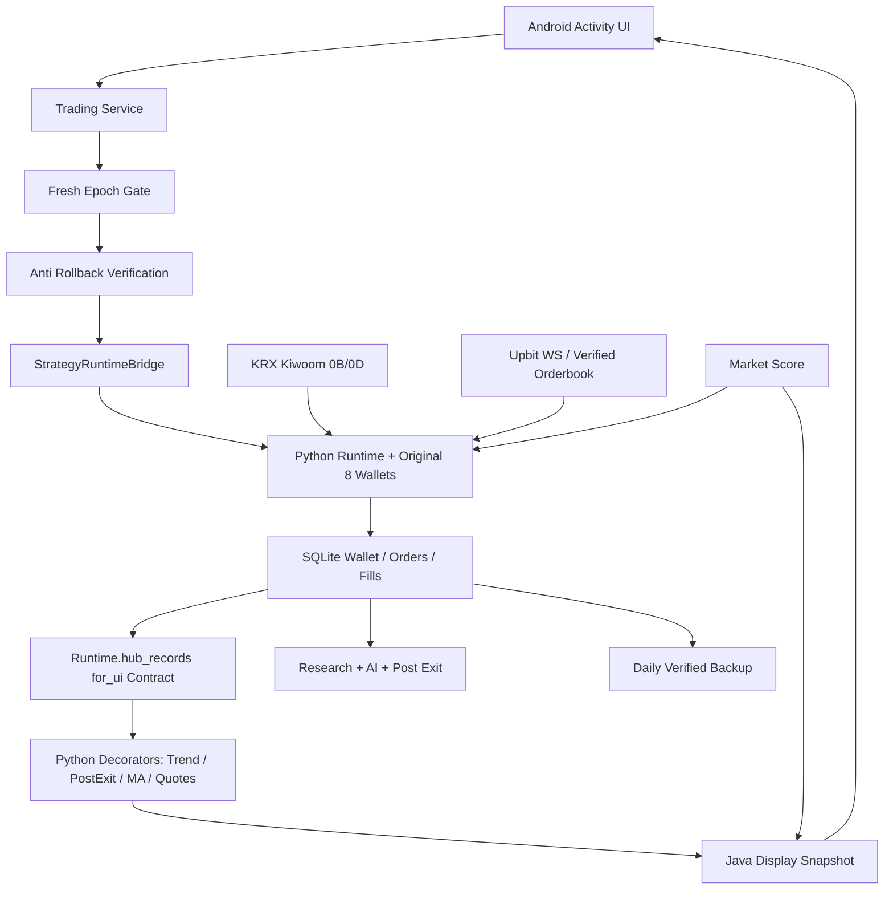

# ARTITRADE — Functional dependency management

**Single source of truth for maintained critical flows:** [dependency_graph.json](dependency_graph.json). **Version/error status:** [version_issues.json](version_issues.json) and the repository [GitHub Issues](https://github.com/OHM1121/RESALE_ALPHA/issues?q=is%3Aissue+ARTITRADE).

## Main interdependencies

## Critical contracts
- **APP_START:** FreshEpochGate → LedgerAntiRollback → Java StrategyRuntimeBridge → Python engine; failed startup may show an Activity but is not running trading.
- **STOCK_FEED:** single Kiwoom WS, official KRX 0B/0D freshness, original AT/MA/GMO/CLOSE/Trend wallets. Rest history is not an executable book. Stock MA preclose has a bounded latest-per-symbol queue.
- **COIN_FEED:** authenticated Upbit ticker/depth, same-market MA/Reference/Trend separate wallets; missing high/low source metadata must not abort other book decisions.
- **HUB_UI:** source SQLite ledger → `android_runtime_v078._hub_records_v078(for_ui)` → Trend → PostExit → PolicyChronology → MA V061 → MA V062 → Stock Quote wrapper → Java bridge → Activity. **Every decorator must retain and forward `for_ui`.** Missing one keyword broke 0.0.5 UI.
- **GMO_EMPTY:** verified zero balances/positions are a healthy fresh epoch, not corruption. Unavailable and actual failures have separate states.
- **BACKUP:** KST +09:00, source SQLite WAL snapshot, independent anti-rollback witness; backup is not a UI export.
- **MKT_TREND_5M:** retired for stock/coin new entry and research. This does **not** retire reference/MA 5m or erase old holdings' exit paths.

## Full-source graph scan
`tools/artitrade/build_source_graph.py` reads (without executing) **all current Python overlays, all 22-archive original EXE strategy Python files, all Java classes and dependency references**, emits `artitrade_source_graph.json`, and labels inferred/dynamic edges as not statically verifiable. The workflow `artitrade-dependency-governance.yml` regenerates and uploads a complete per-commit artifact. If a function is registered dynamically (monkeypatch/callback/serialized event), add it to the critical [dependency_graph.json](dependency_graph.json) manually.

Static references are not equivalent to a validated real broker execution flow. Every missing, unknown or dormant dependency must be disclosed as such, not silently claimed to be inspected.

## Position identity + one-cycle cleanup (0.0.15)
- **POSITION_UID_V015**: original 8 wallet positions/BUY/SELL receipts →
  private epoch-scoped UID sidecar → read-only hub/UI history; no strategy,
  quote, broker or original SQLite wallet writes. Historical closed rows are
  indexed from native source DB, not inferred from symbol+time alone.
- **CFG_SINGLE_PAPER_CLEANUP_V015**: after original old-policy migration and
  before native runtime startup, qualify exactly one historically reported
  coin MA 5m KRW-CFG PAPER position, backup native SQLite, reverse original
  cash/P&L, delete only that position's linked receipts, rebase independent
  witness. Zero or multiple matches are SKIPPED; never bulk ticker deletion.
- Both features require original native regression and Java CI; a GitHub CI
  pass does not prove phone-side migration ran or that any live fill exists.

## 0.0.16 verified preflight visibility and Trend original value provenance
- **PRELOAD_VERIFIED_V016**: original service startup + shared, existing
  Kiwoom/Upbit WS → native preload_gate + KRX 0B/0D / Upbit ticker/book
  + verified completed candle/RSI history → read-only 0.0.16 audit and
  work-item counts → Android status/%/ETA. No new socket/order. 40s UI
  escape leaves original background repair active and never declares ready.
- **TREND_COST_PROVENANCE_V016**: original MT54 position.entry/entry_fee/mark,
  exact native execution.position_id and SELL net_pnl → read-only snapshot
  joined buy unit price/source cost/realized_pct, per-frame PnL → original
  UID display enrichment and Java holdings/execution view. Saved stock mark
  is labelled LAST SAVED NOT LIVE and never controls native SELL orders.
  Original SQLite positions, funds, quantities and policy remain unchanged.
